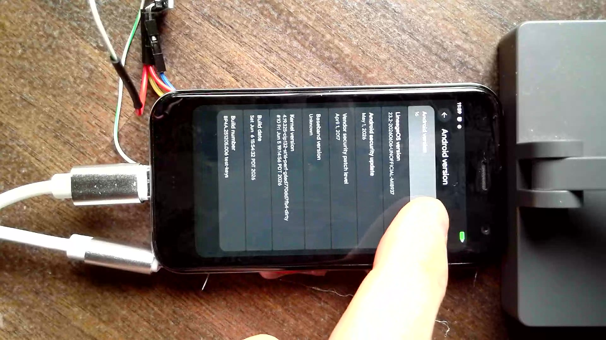
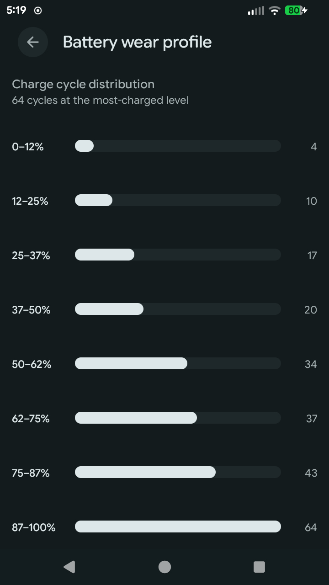
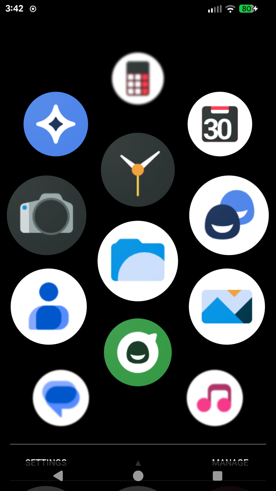

# LineageOS 24.0 for the Palm PVG100 (pepito)



<sup>
This branch is LineageOS 24.0 (Android 17), on hardware that shipped Android 8.1.
The screenshot is from the previous release: LineageOS 23.2, Android 16, kernel 4.19.325, which lives on in the [`lineageos23.2` branch](https://github.com/solarkennedy/lineageos-pepito/tree/lineageos23.2).
▶ [Watch the Android 16 easter egg running on it](assets/pvg100-android16-easter-egg.webm).
</sup>

**Want the download?**
Grab the ROM and flashing instructions from the [releases page](https://github.com/solarkennedy/lineageos-pepito/releases) — pick the **vanilla** build, or the **GApps** build if you want Google apps baked in.
Want something in between? Vanilla plus the optional [microG add-on](docs/MICROG.md).
Or read the full [bring-up write-up](https://kyle.cascade.family/posts/porting-android-16-to-a-palm-pvg100-pepito).

**Questions, or something broken?**
Discussion and support happen in the [XDA thread](https://xdaforums.com/t/rom-unofficial-a16-lineageos-23-2-for-the-palm-pvg100.4795985/); bugs can also go in [issues](https://github.com/solarkennedy/lineageos-pepito/issues).

## Hardware

| | |
|---|---|
| SoC | Qualcomm MSM8940 (Snapdragon 435) + Adreno 505 |
| RAM / storage | 3 GB / 32 GB |
| Display | 3.3″ 720×1280, FocalTech FT8613 in-cell touch |
| Kernel | Linux 4.19.x (mainline-aligned; stock shipped 3.18) |
| Stock OS | Android 8.1 (`v1AML-0`) |

## What works

| Subsystem | Status |
|---|---|
| Telephony (SIM, LTE, VoLTE, calls, SMS) | ✅ |
| Mobile data | ✅ |
| In-call audio (earpiece / speaker / mic) | ✅ |
| Wi-Fi / Bluetooth | ✅ |
| GPS | ✅ |
| Cameras | ✅ |
| Sensors (Compass, IMU, prox, lux, etc) | ✅ |
| HW video encode / decode (Venus) | ✅ |
| FBE encryption, HW Gatekeeper, TEE keys | ✅ |
| SELinux | ✅ Enforcing |

Known limitations, tracked for the [release notes](docs/RELEASE-NOTES.md).

### Pepito extras

This build brings back features the original Palm OS had - and a few quality-of-life additions for a phone with no volume keys:

- **Face Unlock** — the original phone had it, and AOSP/LineageOS ship only a stub matcher.
  This wires in a real RGB recognition engine (a port of Paranoid Android's "Sense"), so you can enroll your face in Settings and unlock by looking at the phone.
  RGB-only hardware, so it's the weak "convenience" tier (still asks for a PIN after reboot / for payments) — the same ceiling the original Palm feature had.
- **Life Mode** — a quick-settings tile reviving Palm's old idea: Do Not Disturb plus aggressive power saving in one tap — kills the radios, drops the screen to greyscale, and enables battery saver.
  On a battery this tiny it meaningfully extends runtime.

  

  <sup>
  Battery wear profile (Settings → System): the fuel gauge's charge-cycle count split into eight 12.5% battery-level bands — where this pack actually got cycled.
  A pepito addition, kernel-fed from the FG's per-SoC buckets.
  </sup>
- **PepitoLauncher2** — a from-scratch reimplementation of the original PVG100 home screen: a single three-column vertical drawer, no labels, with the macOS-dock-style lens zoom as you scroll.
  Decompiled from the stock app to match the exact lens curve and layout.
  Ships alongside the normal launcher — pick it in Settings.
  ([source](https://github.com/solarkennedy/PepitoLauncher2))
- **QS volume slider** — a horizontal volume slider in Quick Settings, because the PVG100 has no hardware volume buttons.
- **Power-key recovery navigation** — the phone has only a power button (no volume keys), so LineageOS recovery was patched to navigate the way stock did: short-press to cycle, long-press to select.



<sup>
PepitoLauncher2: the interlocking three-column drawer with the lens-zoom effect and the SETTINGS / jump / MANAGE bar, rebuilt from the stock 2018 app.
</sup>

## Installation

> The PVG100 has **no Fastboot**.
> First, take a FULL EDL backup (the web flasher's step 3, or step 3 of the command-line procedure below; or the manual [XDA guide](https://xdaforums.com/t/guide-using-edl-to-backup-a-palm-pvg-100-pepito-on-linux.4719549/))!
> There is a risk that your phone is not like mine and has a different partition layout.

DO NOT FLASH UNLESS YOU HAVE A BACKUP FIRST!!!

**Both hardware variants are supported** — the US **PVG100** and the international
**PVG100E** (same images, different partition layout). The release zip contains a
partition XML for each; check the model number on the back of your phone and use
the matching one. **Flashing with the other variant's XML writes over the wrong
partitions, including stock firmware** — the zip's `README.md` spells this out.

### Web flasher (start here)

**<https://solarkennedy.github.io/lineageos-pepito/flasher/>**

A web page that backs up and flashes the phone over USB from Chrome or Edge, with no tools to install. It walks through the whole install:

1. download the release zip, extract it and run the bundled converter (`ota2raw`);
2. put the phone in EDL mode and connect, choosing PVG100 or PVG100E;
3. back up every partition except your data to a folder on your computer;
4. flash.

It is harder to get wrong than the command line. It uses neither partition XML: it reads the phone's own partition table, refuses to continue unless that matches the model you chose, and can only write boot, recovery, system, vendor and `config`. Backups come out in the same format as the command-line tools below, so they restore the same way.

Limits:

- It needs a Chromium browser on a desktop computer.
- **Linux:** the browser needs permission to open the phone, which means a udev rule for `05c6:9008`, and the `qcserial` driver must not be holding it. The page gives both commands under "Connection trouble".
- **Windows:** the phone must be switched to the WinUSB driver with Zadig. This is the opposite of the command-line procedure below, which needs the Qualcomm 9008 serial (COM port) driver. If you switch routes on Windows, switch the driver back.
- It cannot *restore* a backup, which stays a command-line job.

Source: [`docs/flasher`](docs/flasher).

### Command-line procedure

The same install with `qdl`, for when the web flasher is not an option, and for restoring a backup.

Works from **Linux, macOS or Windows**. There is one download per flavor: the same zip is the update package (Updater, `adb sideload`) and, with the `edl/` folder inside it, the first-install kit used here. Its own `README.md` has the same steps in more detail, plus troubleshooting.
PVG100E owners: use `pvg100e_firehose.elf` and `rawprogram0.pvg100e.xml` wherever the PVG100 names appear below.

| | Converting | Flashing | Backup | Status |
|---|---|---|---|---|
| **Linux** (x86-64) | bundled `ota2raw` | bundled `./qdl` | bundled `./qdl-dump.sh` | `ota2raw` is run on every release zip before it is published; `qdl` flashing and backup tested on 23.2 |
| **macOS** | bundled `ota2raw` | [upstream `qdl`](https://github.com/linux-msm/qdl/releases) | bundled `./qdl-dump.sh` | same USB path as Linux, but no run reported yet |
| **Windows** | bundled `ota2raw` | [upstream `qdl.exe`](https://github.com/linux-msm/qdl/releases) | bundled `fh_dump.py` | `qdl` flashing user-reported working on 23.2, Windows 11; `ota2raw` not yet reported |

The one-zip package and `ota2raw` are new in 24.0. If you run them on macOS or Windows, please [tell us](https://github.com/solarkennedy/lineageos-pepito/issues) how it went.

#### 1. Get the zip, convert the images, get the tools

Download the zip from the [releases page](https://github.com/solarkennedy/lineageos-pepito/releases) — **vanilla** or **GApps**, not both — and extract it. Everything from here on happens in its `edl` folder.

The zip stores the system as an update payload, not as flashable images. Run the bundled converter, [`ota2raw`](tools/ota2raw), once: it rebuilds `boot.bin`, `recovery.bin`, `system.bin`, `vendor.bin` and `config.bin` next to the loaders and checks each against a checksum recorded at release time. Allow about 7 GB of disk: the zip, its extracted copy and about 4 GB of images.

```sh
# Linux (ota2raw-linux-arm64 on ARM)
cd edl && chmod +x ota2raw-linux-x86_64 && ./ota2raw-linux-x86_64
# macOS (ota2raw-macos-x86_64 on Intel)
cd edl && xattr -dr com.apple.quarantine . && chmod +x ota2raw-macos-arm64 && ./ota2raw-macos-arm64
```

On Windows, double-click `ota2raw-windows-x86_64.exe` in the `edl` folder (unsigned: *More info* → *Run anyway*).

- **Linux:** nothing else to install beyond `python3`. The bundled `./qdl` is x86-64; on other CPUs grab `qdl-binary-ubuntu-*` from the upstream releases. USB access needs `sudo` or a udev rule for `05c6:9008`.
- **macOS:** download `qdl-binary-macos-arm64-*.zip` (Apple Silicon) or `-intel-` from the [qdl releases](https://github.com/linux-msm/qdl/releases) (v2.8+), copy its `qdl` over the bundled Linux one, and clear the download quarantine: `xattr -dr com.apple.quarantine ./qdl`. No `sudo`, no driver. `python3` comes with `xcode-select --install`.
- **Windows:** unzip `qdl-binary-windows-x64-*.zip` (v2.8+) from the [qdl releases](https://github.com/linux-msm/qdl/releases) into the `edl` folder. For the backup, install [Python 3](https://www.python.org/downloads/) and run `pip install pyserial`. With the phone in EDL, Device Manager must list **Qualcomm HS-USB QDLoader 9008 (COMx)** under *Ports* — install the Qualcomm/Quectel QDLoader driver if it shows as `QUSB_BULK` instead. **No Zadig.**

#### 2. Enter EDL

Any of these works; the [web flasher page](https://solarkennedy.github.io/lineageos-pepito/flasher/) has videos of the last two.

- **adb:** `adb reboot edl`, from Android (turn on USB debugging in Developer options first) or from recovery.
- **Recovery menu:** hold the power button down through three restarts until "Entering Recovery Mode" appears, then choose *Advanced → Reboot to EDL* (LineageOS recovery) or *Emergency Download Mode* (stock recovery; short press moves down, long press selects).
- **EDL cable:** with the phone off, hold the cable's button, plug it in, and let go after a few seconds. This works on a phone that will not start.

The screen stays black. Check: `lsusb` shows `Qualcomm … 9008` (Linux), *System Information → USB* shows `QUSB_BULK` (macOS), or Device Manager shows the 9008 COM port (Windows).

#### 3. Back up — the only way back to stock

Every partition is dumped to its own `.bin`, with a generated `rawprogram_restore.xml` to write it back. `--exclude userdata` skips the (encrypted, useless) data partition: about 8 GB instead of ~29 GB (about 6 GB on a PVG100E).

```sh
# Linux
sudo ./qdl-dump.sh pvg100_firehose.elf backup-$(date +%F) --exclude userdata
# macOS
./qdl-dump.sh pvg100_firehose.elf backup-$(date +%F) --exclude userdata
```

**Windows:** `qdl.exe` can write to this phone but not *read* from it (the PVG100's loader sends sector data in an order qdl's COM-port backend rejects), so the package includes `fh_dump.py`, a read-only dumper. First let qdl upload the loader — this read is **expected to fail**, the loader stays running — then dump over the COM port shown in Device Manager:

```powershell
.\qdl.exe --storage emmc --skip-reset pvg100_firehose.elf read 0/0+34 gpt-test.bin
python fh_dump.py COM10 backup-today --exclude userdata --rom-xml rawprogram0.pvg100.xml
```

`--rom-xml` cross-checks your phone's real partition table against the XML you're about to flash. If it reports anything but `OK - every partition offset and size matches`, **stop** — wrong variant.

To restore a backup later (any OS): `qdl --storage emmc --include backup-DATE pvg100_firehose.elf backup-DATE/rawprogram_restore.xml`.

#### 4. Flash

```sh
sudo ./qdl --storage emmc --allow-missing pvg100_firehose.elf rawprogram0.pvg100.xml    # Linux
./qdl --storage emmc --allow-missing pvg100_firehose.elf rawprogram0.pvg100.xml         # macOS
.\qdl.exe --storage emmc --allow-missing pvg100_firehose.elf rawprogram0.pvg100.xml     # Windows
```

This writes boot, recovery, system, vendor and the small `config` partition only — never the bootloader, modem or other firmware. On Windows one `failed to read sector data` line at the start is harmless.

#### 5. First boot

Coming from stock, `/data` must be reformatted (the switch to file-based encryption). If the phone lands in recovery, choose *Factory reset → Format data*. If it boot-loops instead, **hold Power through 3 boot cycles** until "Entering Recovery Mode", then do the same. The first boot after that takes a few minutes.

## The gory details

See the details in **[bring-up write-up](https://kyle.cascade.family/posts/porting-android-16-to-a-palm-pvg100-pepito)** blog post.

### The full record

The complete working notes — every subsystem's bring-up plan, investigation log, and dead end — live in [plans/](plans/), included verbatim.
[plans/PLAN.md](plans/PLAN.md) is the map.

### Source repos

**This table is the single source of truth** for every repo carrying pepito work — the tree path it lives at, the branch, what's in it, and the fork each is pushed to.
The linked LineageOS repos are the bases the branches are rebased onto (`lineage-24.0`).
It mirrors [`manifests/pepito.xml`](manifests/pepito.xml), last checked against it 2026-10-11.
The Android 16 build's table is in the [`lineageos23.2` branch](https://github.com/solarkennedy/lineageos-pepito/tree/lineageos23.2#source-repos).

| Tree path | Base repo | Branch | Pepito work | Fork |
|---|---|---|---|---|
| `kernel/xiaomi/msm8937` | [android_kernel_xiaomi_msm8937](https://github.com/LineageOS/android_kernel_xiaomi_msm8937) | `pepito-24` | pepito DTs, legacy-IPC backport (the modem fix), TFA9896, BHy hub, RPMB/sdhci fixes | [solarkennedy/android_kernel_xiaomi_msm8937](https://github.com/solarkennedy/android_kernel_xiaomi_msm8937) |
| `device/xiaomi/Mi8937` | [android_device_xiaomi_Mi8937](https://github.com/LineageOS/android_device_xiaomi_Mi8937) | `pepito-24` | pepito variant — qmux radio path, audio, camera HAL, ims_enabler, sepolicy | [solarkennedy/android_device_xiaomi_Mi8937](https://github.com/solarkennedy/android_device_xiaomi_Mi8937) |
| `device/xiaomi/mithorium-common` | [android_device_xiaomi_mithorium-common](https://github.com/LineageOS/android_device_xiaomi_mithorium-common) | `pepito-24` | shared family tree — shims, init, manifest, sepolicy | [solarkennedy/android_device_xiaomi_mithorium-common](https://github.com/solarkennedy/android_device_xiaomi_mithorium-common) |
| `bootable/recovery` | [android_bootable_recovery](https://github.com/LineageOS/android_bootable_recovery) | `pepito-24` | power-key-only menu navigation, EDL reboot, `adbd as root` | [solarkennedy/android_bootable_recovery](https://github.com/solarkennedy/android_bootable_recovery) |
| `frameworks/base` | [android_frameworks_base](https://github.com/LineageOS/android_frameworks_base) | `pepito-24` | QS volume slider (SystemUI, Compose QS), Paranoid Sense face provider, battery state on the lock screen, FULL at the charging limit | [solarkennedy/android_frameworks_base](https://github.com/solarkennedy/android_frameworks_base) |
| `frameworks/native` | [android_frameworks_native](https://github.com/LineageOS/android_frameworks_native) | `pepito-24` | revert libtimeinstate raw-tracepoint attach for `sched_process_free` — part of the zero-CPU-attribution fix on 4.19 | [solarkennedy/android_frameworks_native](https://github.com/solarkennedy/android_frameworks_native) |
| `frameworks/opt/telephony` | [android_frameworks_opt_telephony](https://github.com/LineageOS/android_frameworks_opt_telephony) | `pepito-24` | lets a device opt out of the UICC-applications (SIM on/off) toggle | [solarkennedy/android_frameworks_opt_telephony](https://github.com/solarkennedy/android_frameworks_opt_telephony) |
| `lineage-sdk` | [android_lineage-sdk](https://github.com/LineageOS/android_lineage-sdk) | `pepito-24` | `qs_show_volume_slider` setting + settings-DB upgrade | [solarkennedy/android_lineage-sdk](https://github.com/solarkennedy/android_lineage-sdk) |
| `packages/apps/LineageParts` | [android_packages_apps_LineageParts](https://github.com/LineageOS/android_packages_apps_LineageParts) | `pepito-24` | volume-slider toggle UI | [solarkennedy/android_packages_apps_LineageParts](https://github.com/solarkennedy/android_packages_apps_LineageParts) |
| `packages/apps/Launcher3` | [android_packages_apps_Launcher3](https://github.com/LineageOS/android_packages_apps_Launcher3) | `pepito-24` | taskbar honors `enableTaskbarOnPhones()` on phones (the 3-button-navigation crash fix) | [solarkennedy/android_packages_apps_Launcher3](https://github.com/solarkennedy/android_packages_apps_Launcher3) |
| `packages/apps/Updater` | [android_packages_apps_Updater](https://github.com/LineageOS/android_packages_apps_Updater) | `pepito-24` | "What's new" per-build release notes read from the optional `changelog`/`changelog_url` keys in `pepito.json` (`plans/PLAN-ota-changelog.md`) | [solarkennedy/android_packages_apps_Updater](https://github.com/solarkennedy/android_packages_apps_Updater) |
| `hardware/interfaces` | [android_hardware_interfaces](https://github.com/LineageOS/android_hardware_interfaces) | `pepito-24` | BT binary-BDADDR support, sensors HAL input group, radio compat exits cleanly when the HIDL RIL dies | [solarkennedy/android_hardware_interfaces](https://github.com/solarkennedy/android_hardware_interfaces) |
| `hardware/lineage/interfaces` | [android_hardware_lineage_interfaces](https://github.com/LineageOS/android_hardware_lineage_interfaces) | `pepito-24` | camera torch strength on legacy HALs, camera provider never serves a failed HAL module, radio config wrapper exit | [solarkennedy/android_hardware_lineage_interfaces](https://github.com/solarkennedy/android_hardware_lineage_interfaces) |
| `hardware/qcom-caf/bt` | [android_hardware_qcom_bt](https://github.com/LineageOS/android_hardware_qcom_bt) | `pepito` | Pronto/SMD libbt-vendor bring-up. Upstream dropped this project from 24.0; this is the 23.2 branch, unchanged | [solarkennedy/android_hardware_qcom_bt](https://github.com/solarkennedy/android_hardware_qcom_bt) |
| `system/bpfprogs` | [platform/system/bpfprogs](https://android.googlesource.com/platform/system/bpfprogs) (AOSP; no LineageOS mirror) | `pepito-24` | revert CO-RE/BTF tracepoint-defs support + build timeInState with `-mcpu=v2` for the pre-5.1 kernel BPF verifier — the other half of the zero-CPU-attribution fix | [solarkennedy/android_system_bpfprogs](https://github.com/solarkennedy/android_system_bpfprogs) |
| `system/fs/fs_mgr` | [android_system_fs_fs_mgr](https://github.com/LineageOS/android_system_fs_fs_mgr) | `pepito-24` | silence the f2fs `linear_lookup` open error in recovery (on 23.2 this lived in `system/core`) | [solarkennedy/android_system_fs_fs_mgr](https://github.com/solarkennedy/android_system_fs_fs_mgr) |
| `system/sepolicy` | [android_system_sepolicy](https://github.com/LineageOS/android_system_sepolicy) | `pepito-24` | `pepito_gsfid` domain and its neverallow exemptions (the Play-certification row in Pepito Tweaks) | [solarkennedy/android_system_sepolicy](https://github.com/solarkennedy/android_system_sepolicy) |
| `vendor/lineage` | [android_vendor_lineage](https://github.com/LineageOS/android_vendor_lineage) | `pepito-24` | aconfig overrides (taskbar on phones, flashlight strength slider), externally injected `LINEAGE_BUILD_DATE` | [solarkennedy/android_vendor_lineage](https://github.com/solarkennedy/android_vendor_lineage) |
| `build/make` | [android_build](https://github.com/LineageOS/android_build) | `pepito-24` | lets a device exclude SecureElement, WAPPushManager and ONS | [solarkennedy/android_build](https://github.com/solarkennedy/android_build) |
| `packages/apps/FaceUnlock` | [crdroidandroid/android_packages_apps_FaceUnlock](https://gitlab.com/crdroidandroid/android_packages_apps_FaceUnlock) | `17.0` | Paranoid Sense face unlock app, used as-is | _not forked — pinned to crDroid upstream_ |
| `packages/apps/PepitoLauncher2` | — | `master` | stock-Palm-style launcher reimplementation (whole app) | [solarkennedy/PepitoLauncher2](https://github.com/solarkennedy/PepitoLauncher2) |
| — (this repo) | — | `lineageos24.0` | landing/index: README, BUILD, manifest, plans/, scripts/, the web flasher (`docs/flasher`) and `tools/ota2raw` | [solarkennedy/lineageos-pepito](https://github.com/solarkennedy/lineageos-pepito) |
| `vendor/xiaomi` | — | `pepito-vendor` | curated blob trees (Mi8937 + mithorium-common) with pepito fixups | [solarkennedy/proprietary_vendor_xiaomi](https://github.com/solarkennedy/proprietary_vendor_xiaomi) (private) |

Not in any repo: the release signing keys (`vendor/lineage-priv/`) and the PepitoLauncher2 signing key.

The [manifest](manifests/pepito.xml) in this repo pins the whole tree — see [BUILD.md](BUILD.md).

## Credits

- **LineageOS** and the **Mi-Thorium** team — the unified MSM8937 device/kernel trees this build stands on.
- The postmarketOS msm89x7 work, which informed the modem bring-up.
- Palm's GPL kernel drop (incomplete, but useful).

## Disclaimer

Flashing custom firmware voids warranties and can brick devices.
Nothing here ships Palm/TCL proprietary software; vendor blobs are extracted from a device you own.
Use at your own risk.
